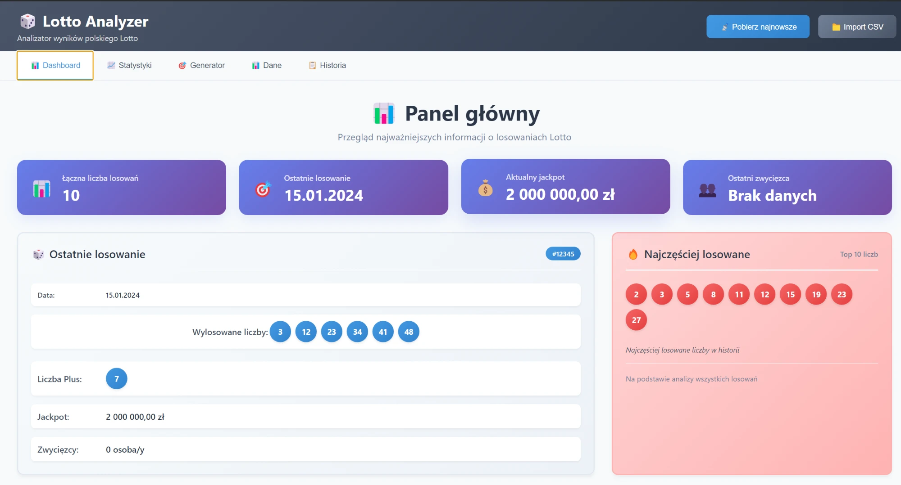
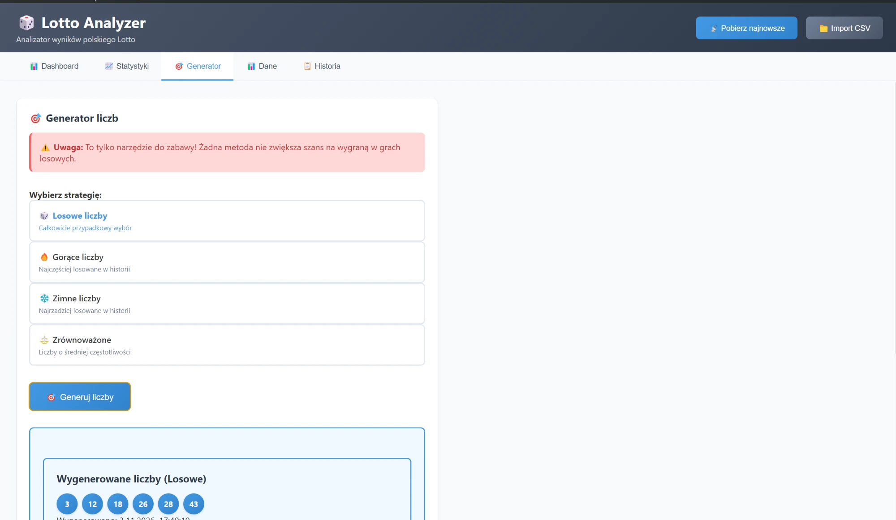

# Lotto Analyzer

Aplikacja desktopowa do przeglądania i analizy wyników polskiego Lotto: statystyki częstości liczb, historia losowań, import danych z CSV i pobieranie najnowszych wyników.

> **Projekt edukacyjny.** Żadna analiza ani „strategia” nie zwiększa szans na wygraną: w Lotto każda kombinacja liczb ma takie same szanse.



## Co robi

- **Panel główny:** liczba losowań, ostatnie losowanie (liczby, Plus, jackpot), najczęściej losowane liczby.
- **Statystyki:** częstość wystąpień każdej liczby, liczby „gorące” i „zimne”.
- **Generator:** cztery tryby dla zabawy: losowe, gorące, zimne i zrównoważone liczby.
- **Historia:** lista zapisanych losowań.
- **Dane:** import z pliku CSV i pobieranie najnowszych wyników z sieci, także z wybranego zakresu dat.



## Technologie

- Electron (proces główny, komunikacja IPC przez preload)
- JavaScript, HTML i CSS bez frameworka (interfejs)
- Dane w lokalnym pliku JSON (`data/lotto-data.json`)

## Uruchomienie

Wymagania: Node.js 16+ i npm.

```bash
npm install
npm start          # uruchomienie aplikacji
npm run dev        # z narzędziami deweloperskimi
```

### Budowanie

```bash
npm run build      # instalator (electron-builder)
npm run pack       # tylko spakowana aplikacja, bez instalatora
```

Pliki trafiają do folderu `dist/`.

## Import CSV

Jeden wiersz = jedno losowanie:

```csv
data,numer_losowania,liczba_1,liczba_2,liczba_3,liczba_4,liczba_5,liczba_6,plus,jackpot
2024-01-15,1,5,12,23,34,41,49,7,5000000
```

## Struktura

```
src/main-simple.js     – proces główny: dane, statystyki, generator, import, pobieranie
src/preload-simple.js  – bezpieczny most między procesem głównym a interfejsem
src/renderer/          – interfejs (index.html, app.js, styles.css)
data/lotto-data.json   – zapisane losowania
```

`src/main.js`, `src/database.js` i `src/scraper.js` to wcześniejsza wersja z bazą SQLite; aplikacja obecnie z niej nie korzysta.

---

Więcej o projekcie: [portfolio](https://portfolio-jakubstachowskii.vercel.app/projekty/lotto-analyzer/)
